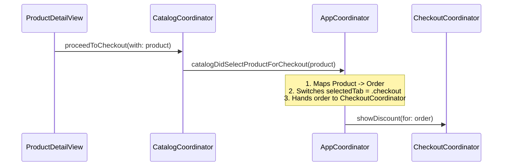

# MVVM-C Navigation Architecture Explanation & Reference Guide

> **Date:** November 11, 2026  
> **Project:** `MVVMC-Blueprint`  
> **Topic:** Comprehensive Guide to Navigation Handling via Coordinators, Navigation Routers, and Navigation Paths in SwiftUI  

---

## 1. Executive Summary

This document explains the end-to-end navigation mechanism in the **MVVM-C (Model-View-ViewModel-Coordinator)** architecture implemented in `MVVMC-Blueprint`. 

The architecture achieves:
- **Zero View Coupling**: SwiftUI Views know nothing about destinations, view instantiation, or other screens.
- **Bi-Directional State Synchronization**: Seamless synchronization between programmatic navigation commands (`push`, `pop`, `popToRoot`) and native iOS gestures (edge back-swipe, back bar button).
- **Zero Inter-Feature Coupling**: Feature modules (such as `Catalog` and `Checkout`) do not import or reference each other; all cross-feature coordination flows through protocol delegates mediated by the root coordinator.

---

## 2. Core Pillars of the Navigation Engine

### 2.1 The Observable Navigation Router (`NavigationRouter`)
File: [`NavigationRouter.swift`](file:///Users/lzeng/Documents/A_Career/A-CareerWorkspace/TechnicalDrilling/MVVMCApp/MVVMC-Blueprint/Sources/MVVMCBlueprint/Core/Navigation/NavigationRouter.swift)

```swift
@MainActor
@Observable
public final class NavigationRouter {
    public var path = NavigationPath()

    public init() {}

    public func push<T: Hashable>(_ route: T) {
        path.append(route)
    }

    public func pop() {
        guard !path.isEmpty else { return }
        path.removeLast()
    }

    public func popToRoot() {
        path = NavigationPath()
    }
}
```

#### Why this works seamlessly in SwiftUI:
1. **`@Observable` Macro**: When `path` changes, any SwiftUI view observing this router automatically updates.
2. **Two-Way Binding**: Inside feature container views, we pass `$coordinator.router.path` directly into SwiftUI's `NavigationStack(path:)`.
3. **Native Back-Swipe Support**: When a user performs an iOS edge back-swipe or taps the native `< Back` navigation item, SwiftUI mutates the bound `path`. Because `path` is encapsulated in `NavigationRouter`, the coordinator's state remains perfectly in sync without extra observers or notifications.

---

### 2.2 Feature Container Views & NavigationStack
Files:
- [`CatalogContainerView.swift`](file:///Users/lzeng/Documents/A_Career/A-CareerWorkspace/TechnicalDrilling/MVVMCApp/MVVMC-Blueprint/Sources/MVVMCBlueprint/Features/Catalog/Views/CatalogContainerView.swift)
- [`CheckoutContainerView.swift`](file:///Users/lzeng/Documents/A_Career/A-CareerWorkspace/TechnicalDrilling/MVVMCApp/MVVMC-Blueprint/Sources/MVVMCBlueprint/Features/Checkout/Views/CheckoutContainerView.swift)

Each top-level tab owns its own dedicated `NavigationStack` bound to its coordinator's router:

```swift
public struct CatalogContainerView: View {
    @Bindable var coordinator: CatalogCoordinator

    public var body: some View {
        NavigationStack(path: $coordinator.router.path) {
            coordinator.buildView(for: .productList)
                .navigationDestination(for: CatalogRoute.self) { route in
                    coordinator.buildView(for: route)
                }
        }
    }
}
```

- **Root View Hosting**: The initial screen (`.productList`) is built directly by the coordinator.
- **Route Resolution via `.navigationDestination`**: Any route appended to `path` matching `CatalogRoute.self` is dispatched to `coordinator.buildView(for:)`.

---

### 2.3 Coordinators as View Factories
Files:
- [`CatalogCoordinator.swift`](file:///Users/lzeng/Documents/A_Career/A-CareerWorkspace/TechnicalDrilling/MVVMCApp/MVVMC-Blueprint/Sources/MVVMCBlueprint/Features/Catalog/Coordinators/CatalogCoordinator.swift)
- [`CheckoutCoordinator.swift`](file:///Users/lzeng/Documents/A_Career/A-CareerWorkspace/TechnicalDrilling/MVVMCApp/MVVMC-Blueprint/Sources/MVVMCBlueprint/Features/Checkout/Coordinators/CheckoutCoordinator.swift)

Coordinators encapsulate dependency injection and screen assembly:

```swift
@ViewBuilder
public func buildView(for route: CatalogRoute) -> some View {
    switch route {
    case .productList:
        ProductListView(viewModel: catalogViewModel)
    case .productDetail(let product):
        ProductDetailView(product: product, coordinator: self)
    }
}
```

- Views do not know about their dependencies (Use Cases, Repositories, Network Services).
- Coordinators instantiate ViewModels, wire dependencies, and return lightweight SwiftUI Views.

---

### 2.4 Strongly-Typed Routes
Files:
- [`CatalogRoute.swift`](file:///Users/lzeng/Documents/A_Career/A-CareerWorkspace/TechnicalDrilling/MVVMCApp/MVVMC-Blueprint/Sources/MVVMCBlueprint/Features/Catalog/Coordinators/CatalogRoute.swift)
- [`CheckoutRoute.swift`](file:///Users/lzeng/Documents/A_Career/A-CareerWorkspace/TechnicalDrilling/MVVMCApp/MVVMC-Blueprint/Sources/MVVMCBlueprint/Features/Checkout/Coordinators/CheckoutRoute.swift)

Routes are `Hashable` and `Sendable` enums carrying strongly-typed domain payloads:

```swift
public enum CheckoutRoute: Hashable, Sendable {
    case inputOrder
    case discount(Order)
    case payment(Order, Discount?)
    case success(PaymentResult)
}
```

---

### 2.5 Cross-Feature Decoupling via Delegate Protocol
Files:
- [`CatalogCoordinatorDelegate.swift`](file:///Users/lzeng/Documents/A_Career/A-CareerWorkspace/TechnicalDrilling/MVVMCApp/MVVMC-Blueprint/Sources/MVVMCBlueprint/Features/Catalog/Coordinators/CatalogCoordinatorDelegate.swift)
- [`AppCoordinator.swift`](file:///Users/lzeng/Documents/A_Career/A-CareerWorkspace/TechnicalDrilling/MVVMCApp/MVVMC-Blueprint/Sources/MVVMCBlueprint/Core/Navigation/AppCoordinator.swift)

When an event requires transitioning to another feature (e.g. from Catalog Product Detail to Checkout):



Implementation in `AppCoordinator`:
```swift
extension AppCoordinator: CatalogCoordinatorDelegate {
    public func catalogDidSelectProductForCheckout(_ product: Product) {
        let orderItem = Order.Item(
            id: UUID(),
            productId: product.id,
            productTitle: product.title,
            price: product.price,
            quantity: 1
        )
        let order = Order(
            id: UUID(),
            items: [orderItem],
            subtotal: product.price
        )

        // 1. Switch active TabView to Checkout tab
        selectedTab = .checkout

        // 2. Direct CheckoutCoordinator to present the discount step
        checkoutCoordinator.showDiscount(for: order)
    }
}
```

---

## 3. Detailed Navigation Flows & Scenarios

### Scenario 1: Intra-Feature Push & Pop
1. User taps product card on `ProductListView`.
2. `CatalogViewModel.selectProduct(product)` calls `coordinator.showProductDetail(product)`.
3. `CatalogCoordinator` executes `router.push(CatalogRoute.productDetail(product))`.
4. `NavigationRouter.path` appends the route enum.
5. SwiftUI's `NavigationStack` detects the mutation via observation, queries `.navigationDestination(for: CatalogRoute.self)`, and calls `coordinator.buildView(for: .productDetail(product))`.
6. **Pop Action**: User swipes from screen edge or taps `< Back`. SwiftUI removes the element from `path`. The router reflects the empty stack `[]`.

### Scenario 2: Checkout Progression & Stack Reset
1. **Discount Step**: `checkoutCoordinator.showDiscount(for: order)` pushes `CheckoutRoute.discount(order)`.
   - Stack: `[.discount]`
2. **Payment Step**: `DiscountViewModel` calls `coordinator.showPayment(for: order, discount: appliedDiscount)`.
   - Stack: `[.discount, .payment]`
3. **Success / Receipt Step**: `PaymentViewModel` processes payment via `ProcessPaymentUseCase` and calls `coordinator.showSuccess(result: paymentResult)`.
   - Stack: `[.discount, .payment, .success]`
4. **Stack Reset (`popToRoot`)**: User taps "Done" on `ReceiptView`.
   - `ReceiptView` calls `onDone()`, invoking `checkoutCoordinator.finishCheckout()`.
   - `checkoutCoordinator` calls `router.popToRoot()`, re-initializing `path = NavigationPath()`.
   - SwiftUI animates the unwinding back to root `CheckoutInputView`.

---

## 4. Responsibility Matrix

| Component | Responsibility | What It Does NOT Do |
| :--- | :--- | :--- |
| **`View`** | Renders UI, receives user touches, triggers ViewModel methods or closure callbacks. | Never creates ViewModels, never references `NavigationLink`, never decides next screen. |
| **`ViewModel`** | Manages UI state, executes business use cases, formats data for display. | Never interacts with UIKit/SwiftUI navigation directly; only notifies coordinator. |
| **`Coordinator`** | Manages navigation flow, acts as View Factory via `buildView(for:)`, injects dependencies into ViewModels. | Does not render UI bodies or handle business logic computations. |
| **`NavigationRouter`** | Holds `@Observable var path = NavigationPath()`, provides `push`, `pop`, `popToRoot`. | Does not know what views are pushed or what business logic is running. |
| **`AppCoordinator`** | Root orchestrator, coordinates Tab switches and cross-feature transitions via delegates. | Does not micro-manage internal sub-flows of child coordinators. |

---

## 5. Generated Diagram Files in the Repository

All diagrams are available in the [`Diagrams`](file:///Users/lzeng/Documents/A_Career/A-CareerWorkspace/TechnicalDrilling/MVVMCApp/MVVMC-Blueprint/Diagrams) folder:

| File | Format | Contents |
| :--- | :--- | :--- |
| [**`navigation_architecture.md`**](file:///Users/lzeng/Documents/A_Career/A-CareerWorkspace/TechnicalDrilling/MVVMCApp/MVVMC-Blueprint/Diagrams/navigation_architecture.md) | Markdown + Mermaid | Interactive markdown guide with native Mermaid diagrams for architecture, router bindings, sequences, and state transitions. |
| [**`04_navigation_architecture.puml`**](file:///Users/lzeng/Documents/A_Career/A-CareerWorkspace/TechnicalDrilling/MVVMCApp/MVVMC-Blueprint/Diagrams/04_navigation_architecture.puml) | PlantUML | Structural component & class diagram for AppCoordinator, Child Coordinators, Routers, Routes, and Views. |
| [**`05_navigation_flows.puml`**](file:///Users/lzeng/Documents/A_Career/A-CareerWorkspace/TechnicalDrilling/MVVMCApp/MVVMC-Blueprint/Diagrams/05_navigation_flows.puml) | PlantUML | End-to-end sequence diagram for intra-feature navigation, cross-feature delegate handoff, and `popToRoot()`. |
| [**`06_navigation_state_transitions.puml`**](file:///Users/lzeng/Documents/A_Career/A-CareerWorkspace/TechnicalDrilling/MVVMCApp/MVVMC-Blueprint/Diagrams/06_navigation_state_transitions.puml) | PlantUML | State machine showing `NavigationPath` stack state changes across all feature screens. |
| [**`architecture_diagrams.puml`**](file:///Users/lzeng/Documents/A_Career/A-CareerWorkspace/TechnicalDrilling/MVVMCApp/MVVMC-Blueprint/Diagrams/architecture_diagrams.puml) | PlantUML | Consolidated PlantUML document containing all 6 architectural and navigation diagrams. |
| [**`architecture_diagrams.md`**](file:///Users/lzeng/Documents/A_Career/A-CareerWorkspace/TechnicalDrilling/MVVMCApp/MVVMC-Blueprint/Diagrams/architecture_diagrams.md) | Markdown | Main architecture reference indexing all layers, dependencies, and navigation documentation. |

---

*Keep this document as a permanent technical drilling reference for modern SwiftUI MVVM-C implementations.*
