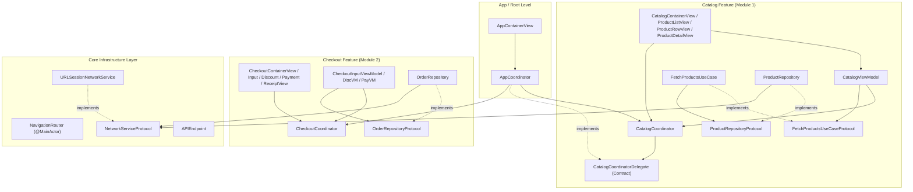

```plantuml
@startuml LayerDependencies
skinparam packageBackgroundColor #F8F9FA
skinparam packageBorderColor #4A90E2
skinparam shadowing false
skinparam roundCorner 8

header MVVM-C Layer Dependencies
title Clean Architecture & Modular Layer Dependency

package "App / Root Level" #FAF0E6 {
    [AppContainerView]
    [AppCoordinator]
}

package "Catalog Feature (Module 1)" #EBF5FB {
    package "Catalog UI" {
        [CatalogContainerView]
        [ProductListView]
        [ProductRowView]
        [ProductDetailView]
    }
    package "Catalog Presentation" {
        [CatalogViewModel]
        [CatalogCoordinator]
        [CatalogCoordinatorDelegate] as CatDelegate
    }
    package "Catalog Domain" {
        [FetchProductsUseCaseProtocol] as FetchUseCaseProto
        [FetchProductsUseCase]
        [ProductRepositoryProtocol] as ProdRepoProto
        [Product Model] as Product
    }
    package "Catalog Data" {
        [ProductRepository]
        [ProductEndpoint]
        [ProductDTO]
    }
}

package "Checkout Feature (Module 2)" #FDF2E9 {
    package "Checkout UI" {
        [CheckoutContainerView]
        [CheckoutInputView]
        [DiscountView]
        [PaymentView]
        [ReceiptView]
    }
    package "Checkout Presentation" {
        [CheckoutCoordinator]
        [CheckoutCoordinatorProtocol] as CoordProto
        [CheckoutInputViewModel]
        [DiscountViewModel]
        [PaymentViewModel]
    }
    package "Checkout Domain" {
        [OrderRepositoryProtocol] as OrderRepoProto
        [CalculateDiscountUseCaseProtocol] as CalcDiscountProto
        [CalculateDiscountUseCase]
        [ProcessPaymentUseCaseProtocol] as ProcessPayProto
        [ProcessPaymentUseCase]
        [Order Model] as Order
        [Discount Model] as Discount
        [PaymentResult Model] as PaymentResult
    }
    package "Checkout Data" {
        [OrderRepository]
        [CheckoutEndpoint]
        [DummyCartDTO]
        [OrderDTO]
    }
}

package "Core Infrastructure Layer" #F5EEF8 {
    [NavigationRouter]
    [NetworkServiceProtocol] as NetProto
    [URLSessionNetworkService]
    [APIEndpoint]
}

' Root Orchestration & Cross-Feature Communication (Zero Direct Feature Coupling)
[AppContainerView] --> [AppCoordinator]
[AppCoordinator] --> [CatalogCoordinator]
[AppCoordinator] ..|> CatDelegate
[AppCoordinator] --> [CheckoutCoordinator]
[CatalogCoordinator] --> CatDelegate

' Catalog Feature Internal Flows (Strict Clean Architecture via Use Case)
[CatalogContainerView] --> [CatalogCoordinator]
[ProductListView] --> [CatalogViewModel]
[ProductListView] ..> [ProductRowView]
[ProductDetailView] --> [CatalogCoordinator]
[CatalogViewModel] --> FetchUseCaseProto
[CatalogViewModel] --> [CatalogCoordinator]
[FetchProductsUseCase] ..|> FetchUseCaseProto
[FetchProductsUseCase] --> ProdRepoProto
[ProductRepository] ..|> ProdRepoProto
[ProductRepository] --> [ProductEndpoint]
[ProductRepository] --> NetProto

' Checkout Feature Internal Flows (Strict Clean Architecture via Use Cases)
[CheckoutContainerView] --> [CheckoutCoordinator]
[CheckoutInputView] --> [CheckoutInputViewModel]
[DiscountView] --> [DiscountViewModel]
[PaymentView] --> [PaymentViewModel]
[ReceiptView] --> [CheckoutCoordinator]
[CheckoutInputViewModel] ..> CoordProto
[CheckoutInputViewModel] --> OrderRepoProto
[DiscountViewModel] ..> CoordProto
[DiscountViewModel] --> CalcDiscountProto
[PaymentViewModel] ..> CoordProto
[PaymentViewModel] --> ProcessPayProto
[CalculateDiscountUseCase] ..|> CalcDiscountProto
[ProcessPaymentUseCase] ..|> ProcessPayProto
[ProcessPaymentUseCase] --> OrderRepoProto
[CheckoutCoordinator] ..|> CoordProto
[OrderRepository] ..|> OrderRepoProto
[OrderRepository] --> [CheckoutEndpoint]
[OrderRepository] --> NetProto

' Core Infrastructure Conformance
[CheckoutEndpoint] ..|> [APIEndpoint]
[ProductEndpoint] ..|> [APIEndpoint]
[URLSessionNetworkService] ..|> NetProto
[AppCoordinator] --> [NavigationRouter]
[CatalogCoordinator] --> [NavigationRouter]
[CheckoutCoordinator] --> [NavigationRouter]

@enduml
```

```plantuml
@startuml ClassDiagram
skinparam classAttributeIconSize 0
skinparam shadowing false
skinparam roundCorner 8
skinparam class {
    BackgroundColor White
    ArrowColor #2C3E50
    BorderColor #2C3E50
}

header MVVM-C Class Diagram
title Detailed Class, Protocol & Entity Architecture

package "App / Root Level" #FAF0E6 {
    class AppContainerView << View >> {
        - appCoordinator: AppCoordinator
        + body: some View (TabView)
    }

    interface Coordinator {
        + childCoordinators: [Coordinator]
        + start()
        + addChild(coordinator: Coordinator)
        + removeChild(coordinator: Coordinator)
    }

    class AppCoordinator << @Observable, @MainActor >> {
        + childCoordinators: [Coordinator]
        + router: NavigationRouter
        + catalogCoordinator: CatalogCoordinator
        + checkoutCoordinator: CheckoutCoordinator
        + selectedTab: Tab
        + start()
        + catalogDidSelectProductForCheckout(product: Product)
    }

    enum "AppCoordinator.Tab" as AppTab {
        case catalog
        case checkout
    }

    class NavigationRouter << @Observable, @MainActor >> {
        + path: NavigationPath
        + push<T: Hashable>(route: T)
        + pop()
        + popToRoot()
    }
}

package "Core Networking Infrastructure" #F5EEF8 {
    interface APIEndpoint {
        + baseURL: URL
        + path: String
        + method: HTTPMethod
        + headers: [String: String]?
        + queryItems: [URLQueryItem]?
        + body: Data?
        + urlRequest(): URLRequest
    }

    interface NetworkServiceProtocol << Sendable >> {
        + request<T: Decodable>(endpoint: APIEndpoint): T async throws
        + requestData(endpoint: APIEndpoint): Data async throws
    }

    class URLSessionNetworkService << Sendable >> {
        - session: URLSession
        + request<T: Decodable>(endpoint: APIEndpoint): T async throws
        + requestData(endpoint: APIEndpoint): Data async throws
    }
}

package "Catalog Feature (Module 1)" #EBF5FB {
    class CatalogContainerView << View >> {
        - coordinator: CatalogCoordinator
        + body: some View (NavigationStack)
    }

    interface CatalogCoordinatorDelegate << AnyObject >> {
        + catalogDidSelectProductForCheckout(product: Product)
    }

    interface CatalogCoordinatorProtocol {
        + showProductDetail(product: Product)
        + proceedToCheckout(with product: Product)
    }

    class CatalogCoordinator << @Observable, @MainActor >> {
        + childCoordinators: [Coordinator]
        + router: NavigationRouter
        + delegate: CatalogCoordinatorDelegate?
        - fetchProductsUseCase: FetchProductsUseCaseProtocol
        - catalogViewModel: CatalogViewModel
        + start()
        + showProductDetail(product: Product)
        + proceedToCheckout(with product: Product)
        + buildView(for route: CatalogRoute): some View
    }

    enum CatalogRoute << Hashable, Sendable >> {
        case productList
        case productDetail(Product)
    }

    class CatalogViewModel << @Observable, @MainActor >> {
        + products: [Product]
        + isLoading: Bool
        + errorMessage: String?
        - coordinator: CatalogCoordinatorProtocol
        - fetchProductsUseCase: FetchProductsUseCaseProtocol
        + loadProducts() async
        + selectProduct(product: Product)
    }

    class ProductListView << View >> {
        - viewModel: CatalogViewModel
    }

    class ProductRowView << View >> {
        + product: Product
    }

    class ProductDetailView << View >> {
        + product: Product
        - coordinator: CatalogCoordinatorProtocol?
        + proceedToCheckout()
    }

    interface ProductRepositoryProtocol << Sendable >> {
        + fetchProducts() async throws: [Product]
        + fetchProductDetails(id: Int) async throws: Product
    }

    interface FetchProductsUseCaseProtocol << Sendable >> {
        + execute() async throws: [Product]
    }

    class FetchProductsUseCase << Sendable >> {
        - repository: ProductRepositoryProtocol
        + execute() async throws: [Product]
    }

    class ProductRepository << Sendable >> {
        - networkService: NetworkServiceProtocol
        + fetchProducts() async throws: [Product]
        + fetchProductDetails(id: Int) async throws: Product
    }

    enum ProductEndpoint {
        case getProducts
        case getProductDetails(id: Int)
    }

    class Product << Entity, Hashable, Identifiable, Sendable >> {
        + id: Int
        + title: String
        + description: String
        + category: String
        + price: Decimal
        + rating: Double
        + thumbnail: String
    }

    class ProductDTO << Codable, Sendable >> {
        + id: Int
        + title: String
        + price: Double
        + rating: Double
        + thumbnail: String
        + toDomain(): Product
    }
}

package "Checkout Feature (Module 2)" #FDF2E9 {
    class CheckoutContainerView << View >> {
        - coordinator: CheckoutCoordinator
        + body: some View (NavigationStack)
    }

    interface CheckoutCoordinatorProtocol {
        + showDiscount(for order: Order)
        + showPayment(for order: Order, discount: Discount?)
        + showSuccess(result: PaymentResult)
        + finishCheckout()
    }

    class CheckoutCoordinator << @Observable, @MainActor >> {
        + childCoordinators: [Coordinator]
        + router: NavigationRouter
        - repository: OrderRepositoryProtocol
        - calculateDiscountUseCase: CalculateDiscountUseCaseProtocol
        - processPaymentUseCase: ProcessPaymentUseCaseProtocol
        + start()
        + showDiscount(for order: Order)
        + showPayment(for order: Order, discount: Discount?)
        + showSuccess(result: PaymentResult)
        + finishCheckout()
        + buildView(for route: CheckoutRoute): some View
    }

    enum CheckoutRoute << Hashable, Sendable >> {
        case inputOrder
        case discount(Order)
        case payment(Order, Discount?)
        case success(PaymentResult)
    }

    class CheckoutInputViewModel << @Observable, @MainActor >> {
        + itemName: String
        + itemPriceText: String
        + quantity: Int
        + isLoadingCart: Bool
        - coordinator: CheckoutCoordinatorProtocol
        - repository: OrderRepositoryProtocol
        + fetchDummyCart(id: Int) async
        + proceedToDiscount()
    }

    class DiscountViewModel << @Observable, @MainActor >> {
        + order: Order
        + promoCodeInput: String
        + appliedDiscount: Discount?
        - coordinator: CheckoutCoordinatorProtocol
        - calculateDiscountUseCase: CalculateDiscountUseCaseProtocol
        + applyPromoCode()
        + skipOrProceedToPayment()
    }

    class PaymentViewModel << @Observable, @MainActor >> {
        + order: Order
        + discount: Discount?
        + finalAmount: Decimal
        - coordinator: CheckoutCoordinatorProtocol
        - processPaymentUseCase: ProcessPaymentUseCaseProtocol
        + processPayment() async
    }

    class CheckoutInputView << View >> {
        - viewModel: CheckoutInputViewModel
    }

    class DiscountView << View >> {
        - viewModel: DiscountViewModel
    }

    class PaymentView << View >> {
        - viewModel: PaymentViewModel
    }

    class ReceiptView << View >> {
        - result: PaymentResult
        - onDone: () -> Void
    }

    interface OrderRepositoryProtocol << Sendable >> {
        + fetchCart(id: Int) async throws: Order
        + submitOrder(order: Order) async throws: Order
        + processPayment(orderId: UUID, amount: Decimal) async throws: PaymentResult
    }

    interface CalculateDiscountUseCaseProtocol << Sendable >> {
        + execute(subtotal: Decimal, promoCode: String): Discount
    }

    interface ProcessPaymentUseCaseProtocol << Sendable >> {
        + execute(orderId: UUID, amount: Decimal) async throws: PaymentResult
    }

    class CalculateDiscountUseCase << Sendable >> {
        + execute(subtotal: Decimal, promoCode: String): Discount
    }

    class ProcessPaymentUseCase << Sendable >> {
        - repository: OrderRepositoryProtocol
        + execute(orderId: UUID, amount: Decimal) async throws: PaymentResult
    }

    class OrderRepository << Sendable >> {
        - networkService: NetworkServiceProtocol
        + fetchCart(id: Int) async throws: Order
        + submitOrder(order: Order) async throws: Order
        + processPayment(orderId: UUID, amount: Decimal) async throws: PaymentResult
    }

    enum CheckoutEndpoint {
        case getCart(id: Int)
        case getCarts
        case addCart(userId: Int, products)
        case processPayment(UUID, Decimal)
    }

    class Order << Entity, Hashable, Identifiable, Sendable >> {
        + id: UUID
        + items: [Item]
        + subtotal: Decimal
    }

    class Discount << Entity, Hashable, Sendable >> {
        + code: String
        + percentage: Decimal
        + amountSaved: Decimal
        + finalAmount: Decimal
    }

    class PaymentResult << Entity, Hashable, Sendable >> {
        + transactionId: String
        + orderId: UUID
        + totalPaid: Decimal
        + status: Status
    }

    class DummyCartDTO << Codable, Sendable >> {
        + id: Int
        + products: [DummyCartProductDTO]
        + total: Double
        + toDomain(): Order
    }
}

' Root & Navigation Conformance
AppContainerView --> AppCoordinator
Coordinator <|.. AppCoordinator
Coordinator <|.. CatalogCoordinator
Coordinator <|.. CheckoutCoordinator

AppCoordinator ..|> CatalogCoordinatorDelegate
AppCoordinator --> CatalogCoordinator
AppCoordinator --> CheckoutCoordinator
AppCoordinator --> NavigationRouter
AppCoordinator --> AppTab
CatalogCoordinator --> CatalogCoordinatorDelegate
CatalogCoordinator ..|> CatalogCoordinatorProtocol
CheckoutCoordinator ..|> CheckoutCoordinatorProtocol

' Catalog Module Relationships
CatalogContainerView --> CatalogCoordinator
CatalogCoordinator --> NavigationRouter
CatalogCoordinator --> CatalogRoute
CatalogCoordinator --> FetchProductsUseCaseProtocol
CatalogViewModel --> CatalogCoordinatorProtocol
CatalogViewModel --> FetchProductsUseCaseProtocol
ProductListView --> CatalogViewModel
ProductListView ..> ProductRowView
ProductDetailView --> CatalogCoordinatorProtocol

FetchProductsUseCaseProtocol <|.. FetchProductsUseCase
FetchProductsUseCase --> ProductRepositoryProtocol
ProductRepositoryProtocol <|.. ProductRepository
ProductRepository --> ProductEndpoint
ProductRepository --> ProductDTO
ProductRepository --> NetworkServiceProtocol
ProductEndpoint ..|> APIEndpoint

' Checkout Module Relationships
CheckoutContainerView --> CheckoutCoordinator
CheckoutCoordinator --> NavigationRouter
CheckoutCoordinator --> CheckoutRoute
CheckoutCoordinator --> OrderRepositoryProtocol
CheckoutCoordinator --> CalculateDiscountUseCaseProtocol
CheckoutCoordinator --> ProcessPaymentUseCaseProtocol

CheckoutInputViewModel --> CheckoutCoordinatorProtocol
CheckoutInputViewModel --> OrderRepositoryProtocol
DiscountViewModel --> CheckoutCoordinatorProtocol
DiscountViewModel --> CalculateDiscountUseCaseProtocol
PaymentViewModel --> CheckoutCoordinatorProtocol
PaymentViewModel --> ProcessPaymentUseCaseProtocol
CheckoutInputView --> CheckoutInputViewModel
DiscountView --> DiscountViewModel
PaymentView --> PaymentViewModel
ReceiptView --> CheckoutCoordinator

CalculateDiscountUseCaseProtocol <|.. CalculateDiscountUseCase
ProcessPaymentUseCaseProtocol <|.. ProcessPaymentUseCase
ProcessPaymentUseCase --> OrderRepositoryProtocol

OrderRepositoryProtocol <|.. OrderRepository
OrderRepository --> CheckoutEndpoint
OrderRepository --> DummyCartDTO
OrderRepository --> NetworkServiceProtocol
CheckoutEndpoint ..|> APIEndpoint

' Infrastructure
NetworkServiceProtocol <|.. URLSessionNetworkService
URLSessionNetworkService --> APIEndpoint

@enduml
```

```plantuml
@startuml SequenceDiagram
autonumber
skinparam responseMessageBelowArrow true
skinparam shadowing false
skinparam roundCorner 8
skinparam sequence {
    ArrowColor #2C3E50
    ActorBorderColor #2C3E50
    LifeLineBorderColor #2C3E50
    LifeLineBackgroundColor #EBF5FB
    ParticipantBorderColor #2C3E50
    ParticipantBackgroundColor White
    BoxBackgroundColor #F8F9FA
    BoxBorderColor #BDC3C7
}

header MVVM-C End-to-End Business Lifecycle
title Complete Multi-Feature Lifecycle: Data Fetching, Cross-Feature Handoff, Calculation & Payment

actor User
box "Root / App Level" #FAF0E6
    participant "AppContainerView" as AppView
    participant "AppCoordinator" as AppCoord
end box

box "Catalog Feature (Module 1)" #EBF5FB
    participant "ProductListView" as CatView
    participant "ProductDetailView" as DetailUI
    participant "CatalogViewModel" as CatVM
    participant "FetchProductsUseCase" as FetchUseCase
    participant "ProductRepository" as ProdRepo
    participant "CatalogCoordinator" as CatCoord
end box

box "Core Infrastructure" #F5EEF8
    participant "URLSessionNetworkService" as NetService
    participant "NavigationRouter" as Router
end box

box "Checkout Feature (Module 2)" #FDF2E9
    participant "CheckoutCoordinator" as CheckCoord
    participant "DiscountViewModel" as DiscVM
    participant "CalculateDiscountUseCase" as DiscUseCase
    participant "DiscountView" as DiscUI
    participant "PaymentViewModel" as PayVM
    participant "ProcessPaymentUseCase" as PayUseCase
    participant "OrderRepository" as OrderRepo
    participant "PaymentView" as PayUI
    participant "ReceiptView" as ReceiptUI
end box

== 1. Catalog Browsing & Network Data Fetching ==
User -> AppView: Launches App
AppView -> CatView: Renders initial Catalog tab
CatView -> CatVM: task { await loadProducts() }
activate CatVM
CatVM -> FetchUseCase: execute()
activate FetchUseCase
FetchUseCase -> ProdRepo: fetchProducts()
activate ProdRepo
ProdRepo -> NetService: request(ProductEndpoint.getProducts)
activate NetService
NetService --> ProdRepo: Decodes ProductDTO array from DummyJSON
deactivate NetService
ProdRepo --> FetchUseCase: Maps ProductDTO to [Product] Domain Entities
deactivate ProdRepo
FetchUseCase --> CatVM: Returns [Product]
deactivate FetchUseCase
CatVM --> CatView: Updates @Observable products array (UI re-renders)
deactivate CatVM

== 2. Product Selection & Detail Presentation ==
User -> CatView: Taps product card (e.g. "iPhone 15")
CatView -> CatVM: selectProduct(product)
activate CatVM
CatVM -> CatCoord: showProductDetail(product) [via CatalogCoordinatorProtocol]
deactivate CatVM
activate CatCoord
CatCoord -> Router: push(CatalogRoute.productDetail(product))
CatCoord -> DetailUI: buildView(for: .productDetail(product))
Router --> User: Displays ProductDetailView with full specifications
deactivate CatCoord

== 3. Cross-Feature Navigation (Delegate Contract) ==
User -> DetailUI: Taps "Add to Cart & Checkout"
DetailUI -> CatCoord: proceedToCheckout(with: product) [CatalogCoordinatorProtocol]
activate CatCoord
CatCoord -> AppCoord: catalogDidSelectProductForCheckout(product) [CatalogCoordinatorDelegate]
deactivate CatCoord
activate AppCoord
AppCoord -> AppCoord: Converts Product -> Domain Order(items, subtotal)
AppCoord -> AppView: Sets selectedTab = .checkout
AppView --> User: Active tab switches to Checkout Tab
AppCoord -> CheckCoord: showDiscount(for: order)
deactivate AppCoord
activate CheckCoord
CheckCoord -> Router: push(CheckoutRoute.discount(order))
CheckCoord -> DiscUI: buildView(for: .discount(order))
Router --> User: Displays DiscountView (Checkout Feature)
deactivate CheckCoord

== 4. Discount Calculation & Business Rules ==
User -> DiscUI: Enters promo code "SAVE20" & taps "Apply"
DiscUI -> DiscVM: applyPromoCode()
activate DiscVM
DiscVM -> DiscUseCase: execute(subtotal, promoCode: "SAVE20")
activate DiscUseCase
DiscUseCase --> DiscVM: Returns Discount(code: "SAVE20", amountSaved: 20%, finalAmount)
deactivate DiscUseCase
DiscVM --> DiscUI: Updates UI with discount & updated total
deactivate DiscVM

User -> DiscUI: Taps "Proceed to Payment"
DiscUI -> DiscVM: skipOrProceedToPayment()
activate DiscVM
DiscVM -> CheckCoord: showPayment(for: order, discount: discount) [CheckoutCoordinatorProtocol]
deactivate DiscVM
activate CheckCoord
CheckCoord -> Router: push(CheckoutRoute.payment(order, discount))
CheckCoord -> PayUI: buildView(for: .payment(order, discount))
Router --> User: Displays PaymentView
deactivate CheckCoord

== 5. Payment Processing & Stack Unwinding ==
User -> PayUI: Taps "Confirm & Pay Now"
PayUI -> PayVM: processPayment()
activate PayVM
PayVM -> PayUseCase: execute(orderId, amount)
activate PayUseCase
PayUseCase -> OrderRepo: processPayment(orderId, amount)
activate OrderRepo
OrderRepo -> NetService: request(CheckoutEndpoint.processPayment)
activate NetService
NetService --> OrderRepo: Mock payment response OK
deactivate NetService
OrderRepo --> PayUseCase: Returns PaymentResult(transactionId: "TXN-...", status: .success)
deactivate OrderRepo
PayUseCase --> PayVM: Returns PaymentResult
deactivate PayUseCase
PayVM -> CheckCoord: showSuccess(result: result) [CheckoutCoordinatorProtocol]
deactivate PayVM
activate CheckCoord
CheckCoord -> Router: push(CheckoutRoute.success(result))
CheckCoord -> ReceiptUI: buildView(for: .success(result))
Router --> User: Displays ReceiptView
deactivate CheckCoord

User -> ReceiptUI: Taps "Done"
ReceiptUI -> CheckCoord: onDone() -> finishCheckout()
activate CheckCoord
CheckCoord -> Router: popToRoot()
Router --> User: Navigation resets to root CheckoutInputView
deactivate CheckCoord

@enduml
```

# MVVM-C Architecture - Dependency & Interaction Diagrams

This document contains visual diagrams (both **Mermaid** for native Markdown rendering and **PlantUML** for extension previews) illustrating the structural dependencies, protocol abstractions, and multi-feature cross-navigation flow of the **MVVM-C (Model-View-ViewModel-Coordinator)** architecture implementation in `MVVMC-Blueprint`.

---

## 1. High-Level Multi-Feature Architecture Layer Dependency

The rule of Multi-Feature Clean Architecture: **Features are strictly isolated from each other. ViewModels depend on Domain Use Case protocols (`FetchProductsUseCaseProtocol`), Use Cases depend on Domain Repository protocols (`ProductRepositoryProtocol`), and Repositories in the Data layer implement them (Dependency Inversion). Cross-feature transitions are coordinated by an App-level Root Coordinator (`AppCoordinator`) through Feature Delegate Protocols (`CatalogCoordinatorDelegate`).**

### Mermaid Diagram

### PlantUML Diagram

---

## 2. Detailed Class & Protocol UML Diagram

### PlantUML Diagram

---

## 3. End-to-End Multi-Feature Sequence Diagram

### PlantUML Diagram

---

## 4. MVVM-C Navigation Architecture & Router Mechanism

For an in-depth breakdown and interactive diagrams of the Navigation Architecture, see:
- 📖 [navigation_architecture.md](file:///Users/lzeng/Documents/A_Career/A-CareerWorkspace/TechnicalDrilling/MVVMCApp/MVVMC-Blueprint/Diagrams/navigation_architecture.md)
- 📊 [04_navigation_architecture.puml](file:///Users/lzeng/Documents/A_Career/A-CareerWorkspace/TechnicalDrilling/MVVMCApp/MVVMC-Blueprint/Diagrams/04_navigation_architecture.puml): Navigation structural diagram (Coordinators, Routers, NavigationStack binding, Route Enums).
- 🔄 [05_navigation_flows.puml](file:///Users/lzeng/Documents/A_Career/A-CareerWorkspace/TechnicalDrilling/MVVMCApp/MVVMC-Blueprint/Diagrams/05_navigation_flows.puml): Step-by-step navigation interaction sequence (intra-feature, cross-feature delegate, `popToRoot`).
- 🔀 [06_navigation_state_transitions.puml](file:///Users/lzeng/Documents/A_Career/A-CareerWorkspace/TechnicalDrilling/MVVMCApp/MVVMC-Blueprint/Diagrams/06_navigation_state_transitions.puml): State transition diagram illustrating the `NavigationPath` stack state changes across flows.
