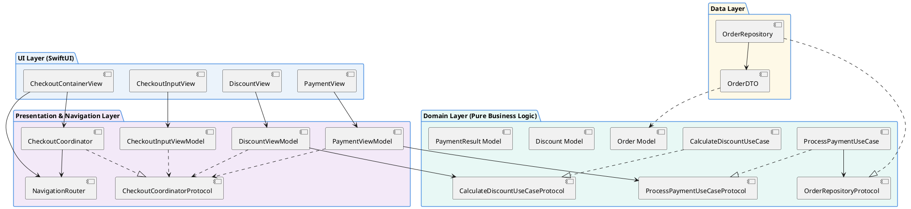
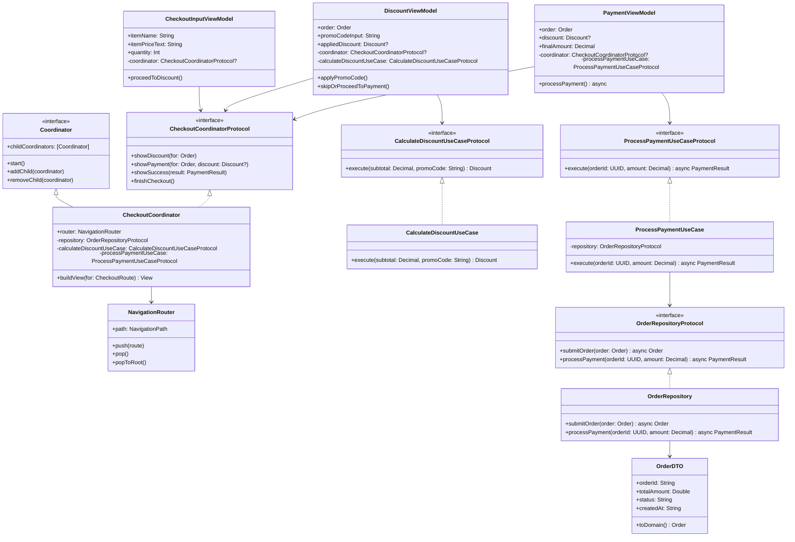
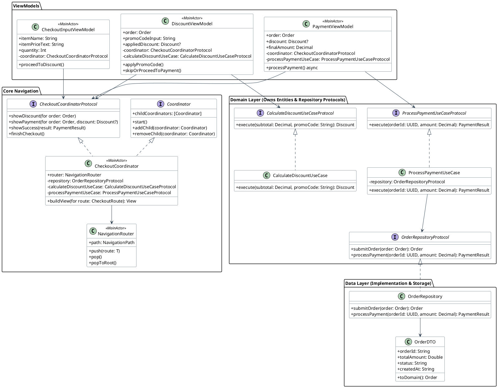
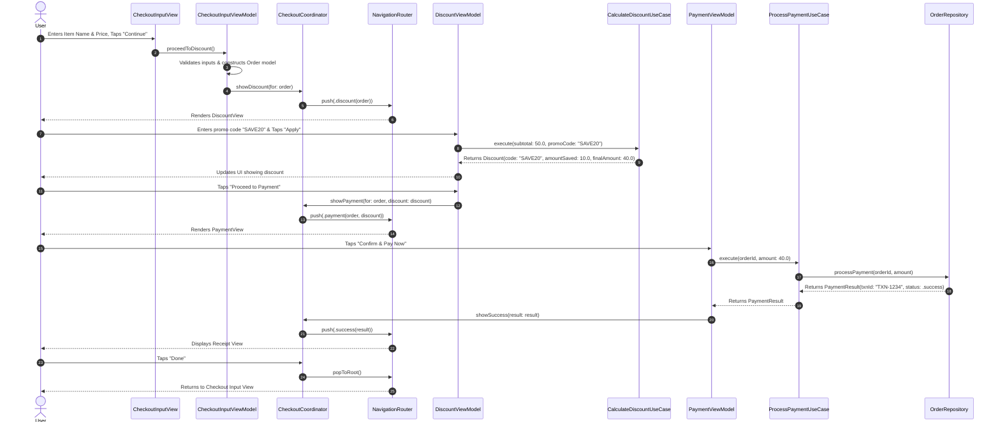
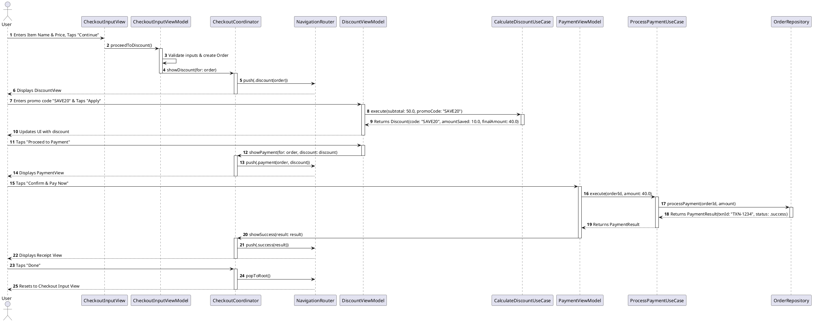

# MVVM-C Architecture - Dependency & Interaction Diagrams

This document contains visual diagrams (both **Mermaid** for native Markdown rendering and **PlantUML** for extension previews) illustrating the structural dependencies, protocol abstractions, and runtime navigation flow of the **MVVM-C (Model-View-ViewModel-Coordinator)** architecture implementation in `MVVMC-Blueprint`.

---

## 1. High-Level Clean Architecture Layer Dependency

The rule of Clean Architecture: **Outer layers depend inward on abstract interfaces; inner domain layers have ZERO knowledge of UI, frameworks, or data persistence.**

### Mermaid Diagram
```mermaid
graph TD
    subgraph UI ["UI Layer (SwiftUI)"]
        Container["CheckoutContainerView"]
        InputView["CheckoutInputView"]
        DiscountView["DiscountView"]
        PaymentView["PaymentView"]
    end

    subgraph Presentation ["Presentation & Navigation Layer"]
        Router["NavigationRouter (@MainActor)"]
        Coordinator["CheckoutCoordinator"]
        InputVM["CheckoutInputViewModel"]
        DiscountVM["DiscountViewModel"]
        PaymentVM["PaymentViewModel"]
    end

    subgraph Domain ["Domain Layer (Pure Business Logic & Protocols)"]
        OrderRepoProtocol["OrderRepositoryProtocol"]
        CalcUseCase["CalculateDiscountUseCaseProtocol"]
        PayUseCase["ProcessPaymentUseCaseProtocol"]
        OrderModel["Order / Discount / PaymentResult Models"]
    end

    subgraph Data ["Data Layer (Implementations & Storage)"]
        OrderRepoImpl["OrderRepository"]
        OrderDTO["OrderDTO"]
    end

    %% UI -> Presentation & Navigation
    Container --> Router
    Container --> Coordinator
    InputView --> InputVM
    DiscountView --> DiscountVM
    PaymentView --> PaymentVM

    %% Presentation -> Coordinator Protocols & Domain
    Coordinator -.-> Router
    InputVM -.->|Delegate/Protocol| CoordinatorProtocol["CheckoutCoordinatorProtocol"]
    DiscountVM -.->|Delegate/Protocol| CoordinatorProtocol
    PaymentVM -.->|Delegate/Protocol| CoordinatorProtocol

    DiscountVM --> CalcUseCase
    PaymentVM --> PayUseCase

    %% Domain -> Data Protocol Boundary (Dependency Inversion)
    PayUseCase --> OrderRepoProtocol
    OrderRepoImpl ..|> OrderRepoProtocol
    OrderRepoImpl --> OrderDTO
    OrderDTO ..> OrderModel
```

### PlantUML Diagram


---

## 2. Detailed Class & Protocol Diagram (UML)

This diagram details protocol decoupling, weak delegation, and dependency injection across all components. Notice that **`OrderRepositoryProtocol` is owned by Domain**, returning pure `Order` Domain Models rather than `OrderDTO`.

### Mermaid Diagram


### PlantUML Diagram


---

## 3. Runtime Sequence Diagram

This sequence diagram depicts what happens when a user creates an order, applies a promo code, and completes payment.

### Mermaid Diagram


### PlantUML Diagram

