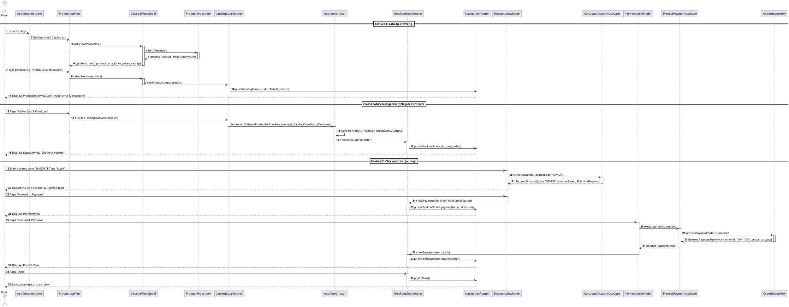

```plantuml
@startuml LayerDependencies
skinparam packageBackgroundColor #F8F9FA
skinparam packageBorderColor #4A90E2

package "App / Root Level" #FAF0E6 {
    [AppContainerView]
    [AppCoordinator]
}

package "Catalog Feature (Module 1)" #EBF5FB {
    package "Catalog UI" {
        [CatalogContainerView]
        [ProductListView]
        [ProductDetailView]
    }
    package "Catalog Presentation" {
        [CatalogViewModel]
        [CatalogCoordinator]
        [CatalogCoordinatorDelegate] as CatDelegate
    }
    package "Catalog Domain" {
        [FetchProductsUseCaseProtocol] as FetchUseCaseProto
        [FetchProductsUseCase]
        [ProductRepositoryProtocol] as ProdRepoProto
        [Product Model] as Product
    }
    package "Catalog Data" {
        [ProductRepository]
        [ProductEndpoint]
        [ProductDTO]
    }
}

package "Checkout Feature (Module 2)" #FDF2E9 {
    package "Checkout UI" {
        [CheckoutContainerView]
        [CheckoutInputView]
        [DiscountView]
        [PaymentView]
    }
    package "Checkout Presentation" {
        [CheckoutCoordinator]
        [CheckoutCoordinatorProtocol] as CoordProto
        [CheckoutInputViewModel]
        [DiscountViewModel]
        [PaymentViewModel]
    }
    package "Checkout Domain" {
        [OrderRepositoryProtocol] as OrderRepoProto
        [CalculateDiscountUseCaseProtocol] as CalcDiscountProto
        [CalculateDiscountUseCase]
        [ProcessPaymentUseCaseProtocol] as ProcessPayProto
        [ProcessPaymentUseCase]
        [Order Model] as Order
        [Discount Model] as Discount
        [PaymentResult Model] as PaymentResult
    }
    package "Checkout Data" {
        [OrderRepository]
        [CheckoutEndpoint]
        [DummyCartDTO]
        [OrderDTO]
    }
}

package "Core Infrastructure Layer" #F5EEF8 {
    [NavigationRouter]
    [NetworkServiceProtocol] as NetProto
    [URLSessionNetworkService]
    [APIEndpoint]
}

' Root Orchestration & Cross-Feature Communication (Zero Direct Feature Coupling)
[AppContainerView] --> [AppCoordinator]
[AppCoordinator] --> [CatalogCoordinator]
[AppCoordinator] ..|> CatDelegate
[AppCoordinator] --> [CheckoutCoordinator]
[CatalogCoordinator] --> CatDelegate

' Catalog Feature Internal Flows (Strict Clean Architecture via Use Case)
[CatalogContainerView] --> [CatalogCoordinator]
[ProductListView] --> [CatalogViewModel]
[ProductDetailView] --> [CatalogCoordinator]
[CatalogViewModel] --> FetchUseCaseProto
[CatalogViewModel] --> [CatalogCoordinator]
[FetchProductsUseCase] ..|> FetchUseCaseProto
[FetchProductsUseCase] --> ProdRepoProto
[ProductRepository] ..|> ProdRepoProto
[ProductRepository] --> [ProductEndpoint]
[ProductRepository] --> NetProto

' Checkout Feature Internal Flows (Strict Clean Architecture via Use Cases)
[CheckoutContainerView] --> [CheckoutCoordinator]
[CheckoutInputView] --> [CheckoutInputViewModel]
[DiscountView] --> [DiscountViewModel]
[PaymentView] --> [PaymentViewModel]
[CheckoutInputViewModel] ..> CoordProto
[CheckoutInputViewModel] --> OrderRepoProto
[DiscountViewModel] ..> CoordProto
[DiscountViewModel] --> CalcDiscountProto
[PaymentViewModel] ..> CoordProto
[PaymentViewModel] --> ProcessPayProto
[CalculateDiscountUseCase] ..|> CalcDiscountProto
[ProcessPaymentUseCase] ..|> ProcessPayProto
[ProcessPaymentUseCase] --> OrderRepoProto
[CheckoutCoordinator] ..|> CoordProto
[OrderRepository] ..|> OrderRepoProto
[OrderRepository] --> [CheckoutEndpoint]
[OrderRepository] --> NetProto

' Core Infrastructure Conformance
[CheckoutEndpoint] ..|> [APIEndpoint]
[ProductEndpoint] ..|> [APIEndpoint]
[URLSessionNetworkService] ..|> NetProto
[AppCoordinator] --> [NavigationRouter]
[CatalogCoordinator] --> [NavigationRouter]
[CheckoutCoordinator] --> [NavigationRouter]

@enduml
```

```plantuml
@startuml ClassDiagram
skinparam classAttributeIconSize 0
skinparam class {
    BackgroundColor White
    ArrowColor #2C3E50
    BorderColor #2C3E50
}

package "App / Root Level" {
    class AppContainerView << View >> {
        -appCoordinator: AppCoordinator
    }

    interface Coordinator {
        +childCoordinators: [Coordinator]
        +start()
        +addChild(coordinator: Coordinator)
        +removeChild(coordinator: Coordinator)
    }

    class AppCoordinator << MainActor >> {
        +router: NavigationRouter
        +catalogCoordinator: CatalogCoordinator
        +checkoutCoordinator: CheckoutCoordinator
        +selectedTab: Tab
        +start()
        +catalogDidSelectProductForCheckout(Product)
    }

    class NavigationRouter << MainActor >> {
        +path: NavigationPath
        +push(route: T)
        +pop()
        +popToRoot()
    }
}

package "Core Networking Infrastructure" {
    interface APIEndpoint {
        +baseURL: URL
        +path: String
        +method: HTTPMethod
        +headers: [String: String]?
        +queryItems: [URLQueryItem]?
        +body: Data?
        +urlRequest(): URLRequest
    }

    interface NetworkServiceProtocol {
        +request(endpoint: APIEndpoint): T
        +requestData(endpoint: APIEndpoint): Data
    }

    class URLSessionNetworkService {
        -session: URLSession
        +request(endpoint: APIEndpoint): T
        +requestData(endpoint: APIEndpoint): Data
    }
}

package "Catalog Feature (Module 1)" {
    class CatalogContainerView << View >> {
        -coordinator: CatalogCoordinator
        -router: NavigationRouter
    }

    interface CatalogCoordinatorDelegate {
        +catalogDidSelectProductForCheckout(Product)
    }

    interface CatalogCoordinatorProtocol {
        +showProductDetail(Product)
        +proceedToCheckout(with: Product)
    }

    class CatalogCoordinator << MainActor >> {
        +router: NavigationRouter
        +delegate: CatalogCoordinatorDelegate?
        -fetchProductsUseCase: FetchProductsUseCaseProtocol
        +showProductDetail(Product)
        +proceedToCheckout(with: Product)
        +buildView(for: CatalogRoute): View
    }

    enum CatalogRoute {
        productList
        productDetail(Product)
    }

    class CatalogViewModel << MainActor >> {
        +products: [Product]
        +isLoading: Bool
        +errorMessage: String?
        -coordinator: CatalogCoordinatorProtocol
        -fetchProductsUseCase: FetchProductsUseCaseProtocol
        +loadProducts() async
        +selectProduct(Product)
    }

    interface ProductRepositoryProtocol {
        +fetchProducts(): [Product]
        +fetchProductDetails(id: Int): Product
    }

    interface FetchProductsUseCaseProtocol {
        +execute(): [Product]
    }

    class FetchProductsUseCase {
        -repository: ProductRepositoryProtocol
        +execute(): [Product]
    }

    class ProductRepository {
        -networkService: NetworkServiceProtocol
        +fetchProducts(): [Product]
        +fetchProductDetails(id: Int): Product
    }

    enum ProductEndpoint {
        getProducts
        getProductDetails(id: Int)
    }

    class Product << Entity >> {
        +id: Int
        +title: String
        +description: String
        +category: String
        +price: Decimal
        +rating: Double
        +thumbnail: String
    }

    class ProductDTO << Codable >> {
        +id: Int
        +title: String
        +price: Double
        +rating: Double
        +thumbnail: String
        +toDomain(): Product
    }
}

package "Checkout Feature (Module 2)" {
    class CheckoutContainerView << View >> {
        -coordinator: CheckoutCoordinator
        -router: NavigationRouter
    }

    interface CheckoutCoordinatorProtocol {
        +showDiscount(for: Order)
        +showPayment(for: Order, discount: Discount?)
        +showSuccess(result: PaymentResult)
        +finishCheckout()
    }

    class CheckoutCoordinator << MainActor >> {
        +router: NavigationRouter
        -repository: OrderRepositoryProtocol
        -calculateDiscountUseCase: CalculateDiscountUseCaseProtocol
        -processPaymentUseCase: ProcessPaymentUseCaseProtocol
        +showDiscount(for: Order)
        +showPayment(for: Order, discount: Discount?)
        +showSuccess(result: PaymentResult)
        +finishCheckout()
        +buildView(for: CheckoutRoute): View
    }

    enum CheckoutRoute {
        inputOrder
        discount(Order)
        payment(Order, Discount?)
        success(PaymentResult)
    }

    class CheckoutInputViewModel << MainActor >> {
        +itemName: String
        +itemPriceText: String
        +quantity: Int
        +isLoadingCart: Bool
        -coordinator: CheckoutCoordinatorProtocol
        -repository: OrderRepositoryProtocol
        +fetchDummyCart(id: Int) async
        +proceedToDiscount()
    }

    class DiscountViewModel << MainActor >> {
        +order: Order
        +promoCodeInput: String
        +appliedDiscount: Discount?
        -coordinator: CheckoutCoordinatorProtocol
        -calculateDiscountUseCase: CalculateDiscountUseCaseProtocol
        +applyPromoCode()
        +skipOrProceedToPayment()
    }

    class PaymentViewModel << MainActor >> {
        +order: Order
        +discount: Discount?
        +finalAmount: Decimal
        -coordinator: CheckoutCoordinatorProtocol
        -processPaymentUseCase: ProcessPaymentUseCaseProtocol
        +processPayment() async
    }

    interface OrderRepositoryProtocol {
        +fetchCart(id: Int): Order
        +submitOrder(order: Order): Order
        +processPayment(orderId: UUID, amount: Decimal): PaymentResult
    }

    interface CalculateDiscountUseCaseProtocol {
        +execute(subtotal: Decimal, promoCode: String): Discount
    }

    interface ProcessPaymentUseCaseProtocol {
        +execute(orderId: UUID, amount: Decimal): PaymentResult
    }

    class CalculateDiscountUseCase {
        +execute(subtotal: Decimal, promoCode: String): Discount
    }

    class ProcessPaymentUseCase {
        -repository: OrderRepositoryProtocol
        +execute(orderId: UUID, amount: Decimal): PaymentResult
    }

    class OrderRepository {
        -networkService: NetworkServiceProtocol
        +fetchCart(id: Int): Order
        +submitOrder(order: Order): Order
        +processPayment(orderId: UUID, amount: Decimal): PaymentResult
    }

    enum CheckoutEndpoint {
        getCart(id: Int)
        getCarts
        addCart(userId: Int, products)
        processPayment(UUID, Decimal)
    }

    class Order << Entity >> {
        +id: UUID
        +items: [Item]
        +subtotal: Decimal
    }

    class Discount << Entity >> {
        +code: String
        +percentage: Decimal
        +amountSaved: Decimal
        +finalAmount: Decimal
    }

    class PaymentResult << Entity >> {
        +transactionId: String
        +orderId: UUID
        +totalPaid: Decimal
        +status: Status
    }

    class DummyCartDTO << Codable >> {
        +id: Int
        +products: [DummyCartProductDTO]
        +total: Double
        +toDomain(): Order
    }
}

' Root & Navigation Conformance
AppContainerView --> AppCoordinator
Coordinator <|.. AppCoordinator
Coordinator <|.. CatalogCoordinator
Coordinator <|.. CheckoutCoordinator

AppCoordinator ..|> CatalogCoordinatorDelegate
AppCoordinator --> CatalogCoordinator
AppCoordinator --> CheckoutCoordinator
AppCoordinator --> NavigationRouter
CatalogCoordinator --> CatalogCoordinatorDelegate
CatalogCoordinator ..|> CatalogCoordinatorProtocol
CheckoutCoordinator ..|> CheckoutCoordinatorProtocol

' Catalog Module Relationships
CatalogContainerView --> CatalogCoordinator
CatalogCoordinator --> NavigationRouter
CatalogCoordinator --> CatalogRoute
CatalogCoordinator --> FetchProductsUseCaseProtocol
CatalogViewModel --> CatalogCoordinatorProtocol
CatalogViewModel --> FetchProductsUseCaseProtocol

FetchProductsUseCaseProtocol <|.. FetchProductsUseCase
FetchProductsUseCase --> ProductRepositoryProtocol
ProductRepositoryProtocol <|.. ProductRepository
ProductRepository --> ProductEndpoint
ProductRepository --> ProductDTO
ProductRepository --> NetworkServiceProtocol
ProductEndpoint ..|> APIEndpoint

' Checkout Module Relationships
CheckoutContainerView --> CheckoutCoordinator
CheckoutCoordinator --> NavigationRouter
CheckoutCoordinator --> CheckoutRoute
CheckoutCoordinator --> OrderRepositoryProtocol
CheckoutCoordinator --> CalculateDiscountUseCaseProtocol
CheckoutCoordinator --> ProcessPaymentUseCaseProtocol

CheckoutInputViewModel --> CheckoutCoordinatorProtocol
CheckoutInputViewModel --> OrderRepositoryProtocol
DiscountViewModel --> CheckoutCoordinatorProtocol
DiscountViewModel --> CalculateDiscountUseCaseProtocol
PaymentViewModel --> CheckoutCoordinatorProtocol
PaymentViewModel --> ProcessPaymentUseCaseProtocol

CalculateDiscountUseCaseProtocol <|.. CalculateDiscountUseCase
ProcessPaymentUseCaseProtocol <|.. ProcessPaymentUseCase
ProcessPaymentUseCase --> OrderRepositoryProtocol

OrderRepositoryProtocol <|.. OrderRepository
OrderRepository --> CheckoutEndpoint
OrderRepository --> DummyCartDTO
OrderRepository --> NetworkServiceProtocol
CheckoutEndpoint ..|> APIEndpoint

' Infrastructure
NetworkServiceProtocol <|.. URLSessionNetworkService
URLSessionNetworkService --> APIEndpoint

@enduml
```

# MVVM-C Architecture - Dependency & Interaction Diagrams

This document contains visual diagrams (both **Mermaid** for native Markdown rendering and **PlantUML** for extension previews) illustrating the structural dependencies, protocol abstractions, and multi-feature cross-navigation flow of the **MVVM-C (Model-View-ViewModel-Coordinator)** architecture implementation in `MVVMC-Blueprint`.

---

## 1. High-Level Multi-Feature Architecture Layer Dependency

The rule of Multi-Feature Clean Architecture: **Features are strictly isolated from each other. ViewModels depend on Domain Use Case protocols (`FetchProductsUseCaseProtocol`), Use Cases depend on Domain Repository protocols (`ProductRepositoryProtocol`), and Repositories in the Data layer implement them (Dependency Inversion). Cross-feature transitions are coordinated by an App-level Root Coordinator (`AppCoordinator`) through Feature Delegate Protocols (`CatalogCoordinatorDelegate`).**

### Mermaid Diagram
```mermaid
graph TD
    subgraph Root ["App / Root Level"]
        AppView["AppContainerView"]
        AppCoord["AppCoordinator"]
    end

    subgraph Catalog ["Catalog Feature (Module 1)"]
        CatView["CatalogContainerView / ProductListView / DetailView"]
        CatCoord["CatalogCoordinator"]
        CatVM["CatalogViewModel"]
        CatDelegate["CatalogCoordinatorDelegate (Contract)"]
        FetchUseCaseProto["FetchProductsUseCaseProtocol"]
        FetchUseCase["FetchProductsUseCase"]
        ProdRepoProto["ProductRepositoryProtocol"]
        ProdRepo["ProductRepository"]
    end

    subgraph Checkout ["Checkout Feature (Module 2)"]
        CheckView["CheckoutContainerView / Input / Discount / Payment"]
        CheckCoord["CheckoutCoordinator"]
        CheckVM["CheckoutInputViewModel / DiscVM / PayVM"]
        OrderRepoProto["OrderRepositoryProtocol"]
        OrderRepo["OrderRepository"]
    end

    subgraph Core ["Core Infrastructure Layer"]
        Router["NavigationRouter (@MainActor)"]
        NetProto["NetworkServiceProtocol"]
        URLSessionEngine["URLSessionNetworkService"]
        APIEndpoint["APIEndpoint"]
    end

    %% Root Navigation & Cross-Feature Coordination
    AppView --> AppCoord
    AppCoord --> CatCoord
    AppCoord ..|> CatDelegate
    AppCoord --> CheckCoord
    CatCoord --> CatDelegate

    %% Catalog Internal (Strict Clean Architecture)
    CatView --> CatVM
    CatView --> CatCoord
    CatVM --> CatCoord
    CatVM --> FetchUseCaseProto
    FetchUseCase -.->|implements| FetchUseCaseProto
    FetchUseCase --> ProdRepoProto
    ProdRepo -.->|implements| ProdRepoProto
    ProdRepo --> NetProto

    %% Checkout Internal
    CheckView --> CheckCoord
    CheckVM --> CheckCoord
    CheckVM --> OrderRepoProto
    OrderRepo -.->|implements| OrderRepoProto
    OrderRepo --> NetProto

    URLSessionEngine -.->|implements| NetProto
```

### PlantUML Diagram


---

## 2. Detailed Class & Protocol UML Diagram

### PlantUML Diagram


---

## 3. End-to-End Multi-Feature Sequence Diagram

### PlantUML Diagram

