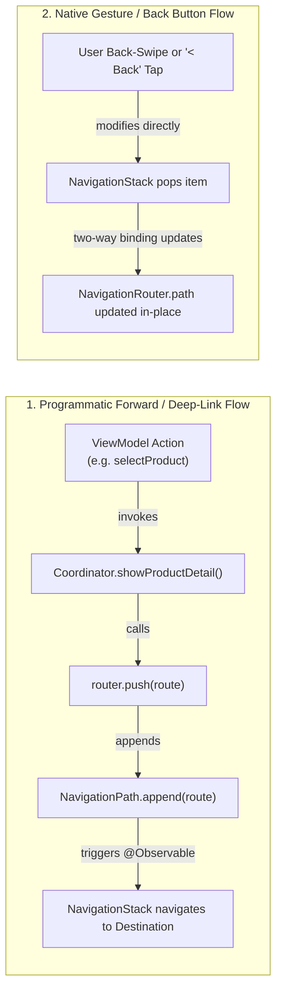
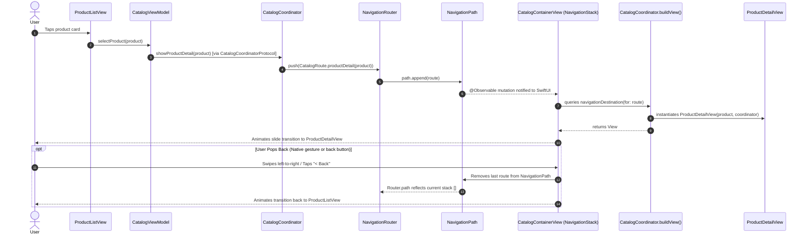
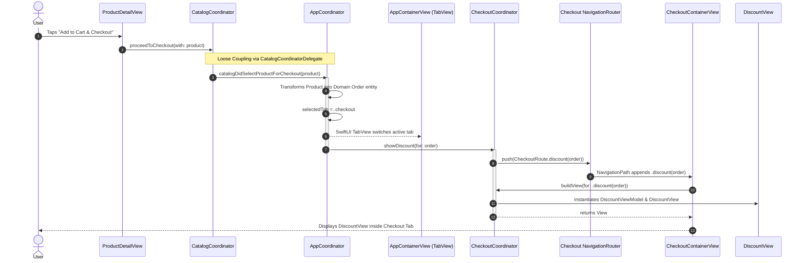

# MVVM-C Navigation Architecture & Router Binding

This document provides a comprehensive analysis and visual specification of how **Navigation** is designed, decoupled, and executed in the `MVVMC-Blueprint` codebase using the **MVVM-C (Model-View-ViewModel-Coordinator)** architectural pattern adapted for modern **SwiftUI** (with Swift Observation and NavigationStack).

---

## 1. Executive Summary & Design Principles

In standard SwiftUI applications, navigation logic is frequently embedded directly inside Views using `NavigationLink(destination:)` or hardcoded `@State var path = NavigationPath()`. This couples views to one another, breaks modularity, prevents reusable flows, and makes unit testing impossible.

In **MVVM-C**:
1. **Views Know Nothing About Destinations**: Views only trigger UI intents on their ViewModel or Coordinator.
2. **ViewModels Know Nothing About Navigation UI**: ViewModels execute business/presentation logic and invoke an abstract Coordinator Protocol (e.g., `CatalogCoordinatorProtocol`).
3. **Coordinators Own Navigation & View Assembly**: Coordinators maintain navigation state, instantiate Views with required dependencies (acting as a **View Factory** via `buildView(for:)`), and push/pop routes.
4. **NavigationRouter Wraps NavigationPath**: An `@Observable` `NavigationRouter` provides an imperative API (`push`, `pop`, `popToRoot`) while binding two-way (`$coordinator.router.path`) to SwiftUI's `NavigationStack(path:)`.
5. **Cross-Feature Communication Uses Delegates**: Modules are 100% decoupled; feature transitions are orchestrated by `AppCoordinator` via delegate interfaces (`CatalogCoordinatorDelegate`).

---

## 2. Navigation Component Architecture Diagram

The diagram below illustrates how `AppCoordinator`, Feature Coordinators, `NavigationRouter`, `NavigationStack`, Route Enums, ViewModels, and Views interlock:

```mermaid
graph TD
    classDef root fill:#FAF0E6,stroke:#D35400,stroke-width:2px;
    classDef core fill:#F5EEF8,stroke:#8E44AD,stroke-width:2px;
    classDef catalog fill:#EBF5FB,stroke:#2980B9,stroke-width:2px;
    classDef checkout fill:#FDF2E9,stroke:#D35400,stroke-width:2px;

    subgraph AppRoot ["Root / App Orchestration Layer"]
        AppView["AppContainerView (TabView)"]:::root
        AppCoord["AppCoordinator (@Observable)"]:::root
        AppTab["AppCoordinator.Tab (.catalog | .checkout)"]:::root
    end

    subgraph CoreNav ["Core Navigation Layer"]
        NavRouter["NavigationRouter (@Observable)"]:::core
        NavPath["SwiftUI NavigationPath"]:::core
    end

    subgraph CatalogFeature ["Catalog Feature Module"]
        CatContainer["CatalogContainerView\nNavigationStack(path: $router.path)"]:::catalog
        CatCoord["CatalogCoordinator"]:::catalog
        CatProto["CatalogCoordinatorProtocol"]:::catalog
        CatDelegate["CatalogCoordinatorDelegate (Contract)"]:::catalog
        CatRoute["CatalogRoute Enum\n(.productList | .productDetail)"]:::catalog
        CatVM["CatalogViewModel"]:::catalog
        ListUI["ProductListView"]:::catalog
        DetailUI["ProductDetailView"]:::catalog
    end

    subgraph CheckoutFeature ["Checkout Feature Module"]
        CheckContainer["CheckoutContainerView\nNavigationStack(path: $router.path)"]:::checkout
        CheckCoord["CheckoutCoordinator"]:::checkout
        CheckProto["CheckoutCoordinatorProtocol"]:::checkout
        CheckRoute["CheckoutRoute Enum\n(.inputOrder | .discount | .payment | .success)"]:::checkout
        CheckVM["CheckoutInputViewModel / DiscountVM / PaymentVM"]:::checkout
        CheckViews["InputView / DiscountView / PaymentView / ReceiptView"]:::checkout
    end

    %% App Root Wiring
    AppView -->|$appCoordinator.selectedTab| AppCoord
    AppCoord --> AppTab
    AppCoord -->|owns child| CatCoord
    AppCoord -->|owns child| CheckCoord
    AppCoord ..|> CatDelegate

    %% Catalog Wiring
    CatContainer -->|observes| CatCoord
    CatContainer -.->|binds $coordinator.router.path| NavRouter
    NavRouter -->|manages| NavPath
    CatCoord -->|owns dedicated| NavRouter
    CatCoord ..|> CatProto
    CatCoord -->|delegates cross-feature| CatDelegate
    CatCoord -->|buildView(for:)| CatRoute
    CatCoord -.->|instantiates| ListUI
    CatCoord -.->|instantiates| DetailUI
    ListUI --> CatVM
    CatVM -->|showProductDetail()| CatProto
    DetailUI -->|proceedToCheckout()| CatProto

    %% Checkout Wiring
    CheckContainer -->|observes| CheckCoord
    CheckContainer -.->|binds $coordinator.router.path| NavRouter
    CheckCoord -->|owns dedicated| NavRouter
    CheckCoord ..|> CheckProto
    CheckCoord -->|buildView(for:)| CheckRoute
    CheckCoord -.->|instantiates| CheckViews
    CheckViews --> CheckVM
    CheckVM -->|showDiscount / showPayment / showSuccess| CheckProto
    CheckCoord -->|finishCheckout() -> popToRoot| NavRouter
```

---

## 3. The SwiftUI `NavigationStack` & `NavigationRouter` Two-Way Binding Mechanism

The bridge between SwiftUI declarative UI and Coordinator imperative navigation is the **`NavigationRouter`**.

### How the Two-Way Synchronization Works



### Code Implementation Pattern

Each feature container establishes the SwiftUI navigation anchor:

```swift
public struct CatalogContainerView: View {
    @State private var coordinator: CatalogCoordinator

    public var body: some View {
        // Two-way binding directly to coordinator's router path
        NavigationStack(path: $coordinator.router.path) {
            coordinator.buildView(for: .productList)
                .navigationDestination(for: CatalogRoute.self) { route in
                    coordinator.buildView(for: route)
                }
        }
    }
}
```

```swift
@MainActor
@Observable
public final class NavigationRouter {
    public var path = NavigationPath()

    public func push<T: Hashable>(_ route: T) {
        path.append(route)
    }

    public func pop() {
        guard !path.isEmpty else { return }
        path.removeLast()
    }

    public func popToRoot() {
        path = NavigationPath()
    }
}
```

---

## 4. Navigation Flow: Intra-Feature Push / Pop Sequence

This sequence traces an intra-feature screen transition within the **Catalog Feature**:



---

## 5. Cross-Feature Navigation: Delegate Pattern & Tab Switch Sequence

When navigating across features (from **Catalog** to **Checkout**), neither feature imports or knows about the other. The **AppCoordinator** orchestrates the transition:



---

## 6. End-to-End Navigation State Machine (Stack State Lifecycle)

The following state machine tracks the exact contents of `NavigationPath` at each phase of the application journey:

```mermaid
stateDiagram-v2
    [*] --> CatalogTab

    state "Catalog Flow (Tab: .catalog)" as CatalogTab {
        state "Root: Product List" as CatRoot {
            description: "Screen: ProductListView | path: []"
        }
        state "Detail: Product Detail" as CatDetail {
            description: "Screen: ProductDetailView | path: [.productDetail(Product)]"
        }
        CatRoot --> CatDetail: coordinator.showProductDetail(product)
        CatDetail --> CatRoot: Native swipe back / pop()
    }

    state "Cross-Feature Transition" as CrossFeature {
        description: "CatCoord -> CatalogCoordinatorDelegate -> AppCoord\nAppCoord switches selectedTab = .checkout"
    }

    CatDetail --> CrossFeature: Taps 'Add to Cart & Checkout'
    CrossFeature --> CheckDiscount: AppCoord calls CheckCoord.showDiscount(order)

    state "Checkout Flow (Tab: .checkout)" as CheckoutTab {
        state "Root: Input Order" as CheckInput {
            description: "Screen: CheckoutInputView | path: []"
        }
        state "Step 1: Discount" as CheckDiscount {
            description: "Screen: DiscountView | path: [.discount(Order)]"
        }
        state "Step 2: Payment" as CheckPayment {
            description: "Screen: PaymentView | path: [.discount, .payment(Order, Discount)]"
        }
        state "Step 3: Receipt" as CheckReceipt {
            description: "Screen: ReceiptView | path: [.discount, .payment, .success(Result)]"
        }

        CheckInput --> CheckDiscount: proceedToDiscount()
        CheckDiscount --> CheckPayment: showPayment(for: order, discount)
        CheckPayment --> CheckReceipt: showSuccess(result)
        CheckReceipt --> CheckInput: finishCheckout() -> router.popToRoot() (path = [])

        CheckPayment --> CheckDiscount: User taps back
        CheckDiscount --> CheckInput: User taps back
    }
```

---

## 7. Architectural Roles & Responsibilities Matrix

| Component | Responsibility | Allowed to Know | Forbidden to Know |
| :--- | :--- | :--- | :--- |
| **`View`** | Render UI and capture user taps/gestures. | Its ViewModel or CoordinatorProtocol. | Other Views, NavigationPath, foreign modules. |
| **`ViewModel`** | Business/presentation state, executes Use Cases, handles view logic. | CoordinatorProtocol, Domain Use Cases/Models. | SwiftUI Navigation APIs, NavigationRouter, NavigationPath, View types. |
| **`Coordinator`** | Flow navigation logic, View Factory (`buildView`), dependency injection. | NavigationRouter, Route Enums, ViewModels, Use Cases, Delegate protocols. | Concrete child/sibling modules, UI layout details. |
| **`NavigationRouter`** | Holds `@Observable var path = NavigationPath()`, exposes push/pop. | `NavigationPath`, Swift Observation. | Any feature View, ViewModel, or business logic. |
| **`AppCoordinator`** | App-level lifecycle, Tab orchestration, cross-module coordination. | Child Coordinators, Delegate protocols, Tab enum. | Internal routing details of individual feature views. |
| **`Delegate Protocol`** | Clean boundary contract between feature coordinators and root coordinator. | Domain Models (`Product`, `Order`). | Specific feature coordinators or UI implementation. |

---

## 8. Summary of Accompanying PlantUML Diagrams

The following stand-alone PlantUML files are stored in this directory:
- [04_navigation_architecture.puml](file:///Users/lzeng/Documents/A_Career/A-CareerWorkspace/TechnicalDrilling/MVVMCApp/MVVMC-Blueprint/Diagrams/04_navigation_architecture.puml): Structural Class & Component diagram showing all coordinators, routers, protocols, and views.
- [05_navigation_flows.puml](file:///Users/lzeng/Documents/A_Career/A-CareerWorkspace/TechnicalDrilling/MVVMCApp/MVVMC-Blueprint/Diagrams/05_navigation_flows.puml): Comprehensive sequence diagram tracing intra-feature push, cross-feature delegation, and `popToRoot` unwinding.
- [06_navigation_state_transitions.puml](file:///Users/lzeng/Documents/A_Career/A-CareerWorkspace/TechnicalDrilling/MVVMCApp/MVVMC-Blueprint/Diagrams/06_navigation_state_transitions.puml): State transition diagram illustrating the `NavigationPath` stack state changes across user journeys.
